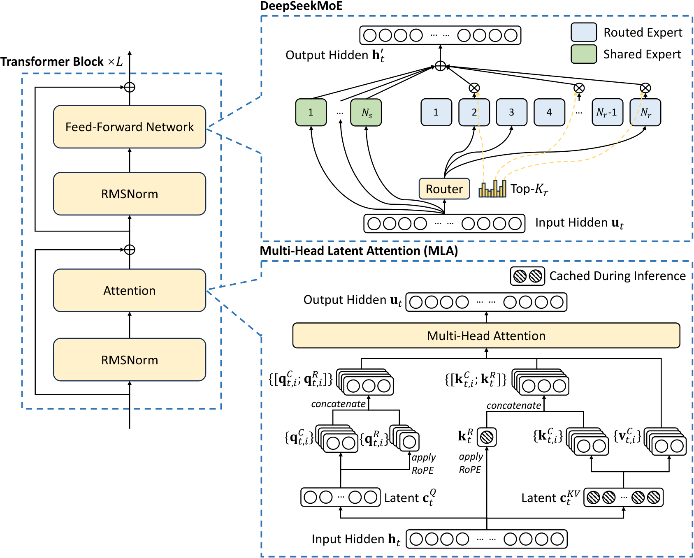
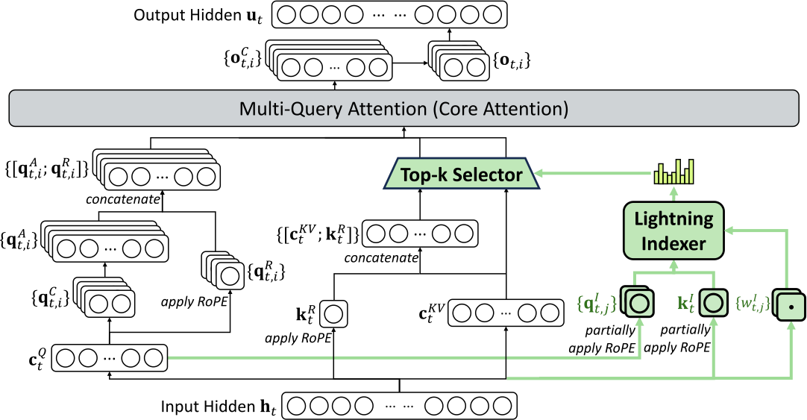
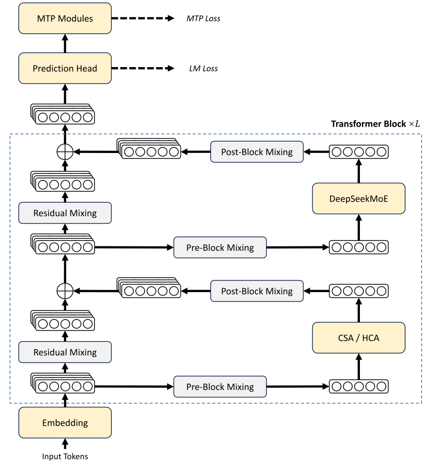
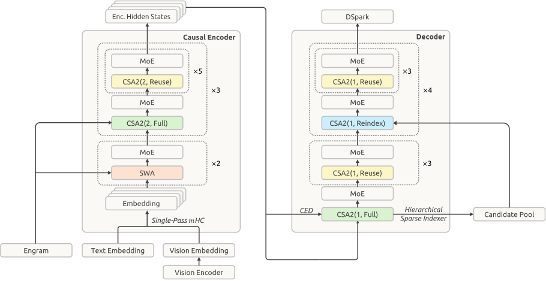

# LLM推理全流程与当前主流LLM架构

## 1. 文本如何变成下一个 token

### 1.1 主要流程
以常见的 Decoder-only 自回归语言模型为例，一次生成的主要流程如下：

```text
输入文本
  → Tokenizer：将文本编码成 token ID 序列
  → Embedding：将每个 token ID 映射为向量
  → 多个 Transformer 层：结合上下文计算隐藏状态
  → 最终归一化（常见模型采用）
  → LM Head：将隐藏状态映射为词表中各 token 的 logits
  → 解码策略：根据 logits 选择下一个 token ID
  → 将新 token ID 追加到序列，继续生成
```


### 1.2 解码策略

解码策略决定如何根据模型的输出选择下一个 token。**采样属于解码策略的一类**；贪心解码和标准 Beam Search 则不依赖随机抽样。

#### 1.2.1 从 logits 到概率

设词表大小为 $V$，当前生成位置的 LM Head 输出为 $z=(z_1,\ldots,z_V)$。其中 $z_i$ 是第 $i$ 个 token 的 logit，可以为正或负，各项之和也不需要等于 1。

通过 Softmax 可以将 logits 转为下一个 token 的条件概率：

$$
p_i=P(x_{t+1}=i\mid x_{\le t})
=\frac{\exp(z_i)}{\sum_{j=1}^{V}\exp(z_j)}
$$

这里的条件 $x_{\le t}$ 包含当前全部输入与已生成的 token。每生成一个新 token，上下文就会变化，模型需要重新计算下一步的分布。

为方便比较，后面的例子都假设当前只有五个候选 token，原始概率如下。A～E 是 token 的代称，不代表实际文字。

| 候选 token | A | B | C | D | E |
|---|---:|---:|---:|---:|---:|
| 概率 | 0.40 | 0.30 | 0.15 | 0.10 | 0.05 |

#### 1.2.2 贪心解码与随机采样

**贪心解码（Greedy Decoding）**：每一步都选择当前分数最高的 token。

$$
x_{t+1}=\arg\max_i z_i
$$

例子中会选择 A。由于 Softmax 不改变大小顺序，贪心解码无需显式计算完整概率。它只保证当前这一步的选择概率最高，不保证最终整条序列的联合概率最高，也不保证事实正确。

**随机采样（Random / Multinomial Sampling）**：按照概率分布抽取一个 token。例子中，A 有 40% 的机会被选中，B 有 30% 的机会，E 也有 5% 的机会。这里不是从候选集合中等概率抽取。

如果直接在完整词表上采样，低概率候选也可能被抽到。温度和候选截断方法用于进一步控制分布。Transformers 中，单路径随机采样可通过 `do_sample=True, num_beams=1` 启用。[参考：Transformers 解码策略](https://huggingface.co/docs/transformers/generation_strategies)

#### 1.2.3 Temperature：调整概率分布的集中程度

温度 $T>0$ 通过缩放 logits 改变概率：

$$
p_i(T)=\frac{\exp(z_i/T)}{\sum_{j=1}^{V}\exp(z_j/T)}
$$

| 温度 | 对分布的影响 |
|---|---|
| $0<T<1$ | 分布更集中，高分候选更占优势 |
| $T=1$ | 保持原始 Softmax 分布 |
| $T>1$ | 分布更平坦，低分候选获得更多机会 |

温度不会改变 logits 的排序。因此，如果最终仍然取 `argmax`，单独调整正温度不会改变所选 token；它主要影响随机采样及后续基于概率的过滤。[参考：TemperatureLogitsWarper](https://huggingface.co/docs/transformers/internal/generation_utils#transformers.TemperatureLogitsWarper)

当最大 logit 唯一时，$T\to0^+$ 的分布趋向于集中在该 token 上。但**不能直接在公式中代入 $T=0$**。部分引擎把 `temperature=0` 约定为切换到贪心解码，例如 vLLM；具体配置方式应以框架为准。

#### 1.2.4 Top-k、Top-p 与 Min-p：筛选候选 token

这些方法先保留一部分候选，再对保留的概率重新归一化并采样。若保留集合为 $S$，则最终分布为：

$$
q_i=\begin{cases}
\dfrac{p_i}{\sum_{j\in S}p_j}, & i\in S \\
0, & i\notin S
\end{cases}
$$

**Top-k：按候选数量截断。** 只保留概率最高的 $k$ 个 token。例如 `top_k=2` 时，保留 A、B，重新归一化后的概率分别为 $0.4/0.7\approx57.14\%$ 和 $0.3/0.7\approx42.86\%$。它简单直接，但固定数量不能反映模型在不同位置的确定程度。

**Top-p（Nucleus Sampling，核采样）：按累计概率截断。** 将候选按概率从高到低排序，保留累计概率第一次达到或超过阈值 $p$ 的最短前缀。例如 `top_p=0.8` 时，A、B 的累计概率只有 0.70，需要再保留 C，累计概率达到 0.85。最终在 A、B、C 中按比例采样。

Top-p 的候选数量会随分布变化：概率集中时可能只保留一个候选，概率分散时可能保留很多个。`top_p=1` 表示不通过这一规则截断。[参考：Nucleus Sampling 原论文](https://arxiv.org/abs/1904.09751)

**Min-p：按相对于最高概率的阈值截断。** 设参数为 $m$，保留满足 $p_i\ge m\cdot p_{\max}$ 的候选。例如 `min_p=0.3` 时，最高概率为 0.40，阈值为 0.12，因此保留 A、B、C。它不是“保留概率大于 0.3 的 token”。[参考：Transformers 生成参数](https://huggingface.co/docs/transformers/main_classes/text_generation)

在上述同一组原始概率下，单独使用各规则的结果如下：

| 方法 | 保留的候选 | 选择方式或归一化后的概率 |
|---|---|---|
| 贪心解码 | A | 直接选择 A |
| 全词表随机采样 | A、B、C、D、E | 40%、30%、15%、10%、5% |
| Top-k，$k=2$ | A、B | 约 57.14%、42.86% |
| Top-p，$p=0.8$ | A、B、C | 约 47.06%、35.29%、17.65% |
| Min-p，$m=0.3$ | A、B、C | 约 47.06%、35.29%、17.65% |

Top-p 与 Min-p 在这个例子中恰好保留相同候选，但判断规则不同，一般不会得到相同结果。

#### 1.2.5 重复惩罚与其他生成约束

除了温度和概率截断，还可以先修改 logits，以影响 token 被选中的机会。

| 机制 | 作用 | 不施加惩罚的值 |
|---|---|---|
| Presence Penalty | 根据 token 是否已经出现进行惩罚，正值降低已出现 token 的分数 | 0 |
| Frequency Penalty | 根据 token 已出现的次数进行惩罚，正值使高频 token 受到更多惩罚 | 0 |
| Repetition Penalty | 对已出现 token 的 logits 进行符号相关的缩放，大于 1 时抑制重复 | 1 |

以常见的加法惩罚形式为例，设 token $i$ 在纳入统计的历史中出现 $c_i$ 次：

$$
z'_i=z_i-\alpha_{\mathrm{presence}}\mathbf{1}[c_i>0]
-\alpha_{\mathrm{frequency}}c_i
$$

其中 $\mathbf{1}[c_i>0]$ 表示出现过取 1，否则取 0。Presence Penalty 只判断是否出现，Frequency Penalty 则区分出现一次和多次。具体统计是否包含 prompt 取决于实现；例如 vLLM 的这两项统计生成部分，而 Repetition Penalty 会考虑 prompt 和生成部分。[参考：vLLM SamplingParams](https://docs.vllm.ai/en/stable/api/vllm/sampling_params/)

常见的 Repetition Penalty 实现对历史中出现过的 token 使用以下规则，$r>1$ 表示抑制重复：

$$
z'_i=\begin{cases}
z_i/r, & z_i>0 \\
r z_i, & z_i\le0
\end{cases}
$$

这样正分数变小、负分数变得更负，都会降低该候选的相对竞争力。它与“按出现次数减分”不同，通常对每个已出现的 token ID 每轮只应用一次。[参考：RepetitionPenaltyLogitsProcessor](https://huggingface.co/docs/transformers/internal/generation_utils#transformers.RepetitionPenaltyLogitsProcessor)

重复惩罚针对 token，不理解语义上的重复；惩罚过强也可能干扰合理的术语复用。其他常见控制包括：

- **Logit Bias：** 对指定 token 的分数增加或减少偏置。
- **禁止候选或重复 n-gram：** 将不允许的候选屏蔽，常用实现是将对应 logit 设为 $-\infty$。
- **结构化约束：** 根据当前语法状态屏蔽不合法候选，用于 JSON、枚举值等受约束输出。
- **停止条件：** EOS、停止字符串和生成长度上限用于决定何时结束；它们与“本轮如何选 token”是两个层面。最小生成长度则可能通过暂时屏蔽 EOS 等结束 token 实现。

#### 1.2.6 Beam Search：同时保留多条候选序列

标准 Beam Search（束搜索）在每一步扩展候选序列，并保留得分最高的 $B$ 条，其中 $B$ 是 beam width。它比较的是序列得分，基础形式是逐 token 条件概率的对数之和：

$$
\log P(x_{1:n}\mid\text{prompt})
=\sum_{t=1}^{n}\log P(x_t\mid\text{prompt},x_{<t})
$$

实际实现还可能使用长度惩罚等修正。Beam Search 相比贪心解码能保留更多路径，但有限的 beam width 仍不保证找到全局最优序列；概率更高也不等于内容更正确。[参考：Transformers Beam Search](https://huggingface.co/docs/transformers/generation_strategies#beam-search)

从推理系统角度，它需要维护多条序列的状态和 KV Cache，增加计算、调度与显存管理开销；前缀共享可以减少部分缓存重复。它与“同一 prompt 独立随机生成 $B$ 个回答”不同：Beam Search 会在生成过程中比较和淘汰候选路径。

#### 1.2.7 多种规则如何组合

下面是一种便于理解的执行顺序，**不是所有框架统一采用的固定顺序**：

```text
LM Head 输出 logits
  → 重复惩罚、Logit Bias 等分数处理
  → 屏蔽不合法候选
  → 若使用贪心：直接 argmax
  → 若使用采样：温度缩放
              → Top-k / Top-p / Min-p 等候选过滤
              → 对剩余候选归一化
              → 按最终分布抽样
  → 追加选出的 token，并检查停止条件
```

这些操作不一定可以交换顺序。例如先 Top-k 再 Top-p，后者可能基于 Top-k 后重新归一化的分布判断累计概率，而不是基于原始全词表分布。温度虽然不改变排名，却会改变概率，因此也可能改变 Top-p 和 Min-p 保留的集合。

过滤通常通过将候选 logits 设为 $-\infty$ 实现；实际引擎也可以融合相关操作，避免反复排序或显式构造完整概率数组。


## 2. 当前主流大模型的架构

### 2.1 DeepSeek

#### 2.1.1 DeepSeek-V3

##### 整体架构



图：DeepSeek-V3 技术报告 Figure 2，位于 PDF 第 7 页。图片提取自报告原图；左侧展示 Transformer Block，右上展开 DeepSeekMoE，右下展开 MLA。[技术报告（v2）](https://arxiv.org/html/2412.19437v2#S2.F2) · [PDF 原文](https://arxiv.org/pdf/2412.19437v2#page=7)

DeepSeek-V3 采用 Decoder-only 自回归 Transformer。每个主干 Block 都使用 MLA 注意力；前 3 个 Block 使用 Dense FFN，后 58 个 Block 使用 MoE FFN。图左侧的 Feed-Forward Network 对应这一前馈子层，两个子层前均有 RMSNorm，并配有残差连接。

主干的简化计算流程如下：

```text
输入 token ID → Embedding
    → 3 个 Block：MLA + Dense FFN
    → 58 个 Block：MLA + DeepSeekMoE
    → 最终 RMSNorm → LM Head
    → 解码策略选择下一个 token
```

主干之外还包含 MTP 辅助模块，其结构在报告 Figure 3 中单独展示，后续讨论 MTP 时展开。[官方模型配置](https://huggingface.co/deepseek-ai/DeepSeek-V3/blob/main/config.json) · [官方权重结构说明](https://github.com/deepseek-ai/DeepSeek-V3/blob/main/README_WEIGHTS.md)

##### 主要参数

| 项目 | DeepSeek-V3 |
|---|---|
| 主干总参数量 | 约 671B；MTP 辅助模块另计 |
| 每个 token 激活的参数量 | 约 37B |
| 主干 Transformer 层数 | 61 层：前 3 层为 Dense FFN，后 58 层为 MoE FFN |
| 隐藏维度 | 7168 |
| MLA 注意力头数 | 128 |
| 每个 MoE 层的专家组成 | 256 个路由专家 + 1 个共享专家 |
| 每个 token 在一个 MoE 层使用的专家 | 8 个路由专家 + 1 个共享专家 |
| 开放权重中的 MTP 辅助模块数 | 1 个，位于 61 层主干之外 |

参数来源：[官方模型卡](https://huggingface.co/deepseek-ai/DeepSeek-V3#3-model-downloads)、[模型配置](https://huggingface.co/deepseek-ai/DeepSeek-V3/blob/main/config.json)、[权重结构说明](https://github.com/deepseek-ai/DeepSeek-V3/blob/main/README_WEIGHTS.md)。

总参数量与激活参数量描述的是不同维度。671B 反映模型拥有的参数规模，37B 反映一个 token 的计算所涉及的参数规模。未被当前 token 选中的专家仍需存储，并在后续被其他 token 选中时可供访问，因此不能按 37B Dense 模型估算整个 V3 的权重存储需求。

##### 三项主要设计

| 设计 | 核心内容 | 推理学习关注点 |
|---|---|---|
| DeepSeekMoE | 细粒度路由专家与共享专家组合，每个 token 只使用部分专家；V3 在此基础上采用 Auxiliary-Loss-Free 负载均衡策略 | 稀疏计算、专家负载、权重存储、跨设备路由与通信 |
| MLA（Multi-head Latent Attention，多头潜在注意力） | 对 Key 和 Value 进行低秩联合压缩，并结合解耦的 RoPE 分支保存必要的历史信息 | KV Cache 的表示与容量，以及注意力计算和访存方式 |
| MTP（Multi-Token Prediction，多 token 预测） | 通过辅助模块引入预测后续多个 token 的训练目标；模块也可用于推测解码 | 训练目标与推理执行的区别，以及草拟、验证带来的加速机会 |

DeepSeekMoE 和 MLA 继承自 V2；V3 的进一步变化包括新的负载均衡策略和 MTP。MTP 模块可以在常规推理中舍弃，使用它加速时仍需相应的推测解码流程。报告中的 FP8 混合精度训练、DualPipe 等技术，则属于数值计算与训练系统方面的设计。[技术报告：架构部分](https://arxiv.org/html/2412.19437v2#S2) · [官方模型介绍](https://github.com/deepseek-ai/DeepSeek-V3#2-model-summary)

##### 设计一：DeepSeekMoE

在 Dense 模型中，每个 token 都经过当前层同一个 FFN。V3 的 MoE 层则包含多套 FFN，称为专家。各专家的网络结构相同，但参数不同；每个 MoE 层有 256 个路由专家和 1 个共享专家。

设 $x$ 是经过前馈子层前的 RMSNorm 后、送入 MoE 的一个 token 的隐藏向量，其维度为 7168。这个 token 的计算过程可以分为四步：

1. 输入隐藏向量 $x$。
2. Router 根据 $x$ 计算路由专家的分数，按路由规则选出 8 个专家。
3. 被选中的 8 个路由专家和共享专家分别处理同一个 $x$，各自产生与输入维度相同的输出向量。
4. 将路由专家的输出加权求和，再加上共享专家的输出，得到前馈子层的结果 $y$。

用结构示意公式表示：

$$
y=E_{\mathrm{shared}}(x)
+\sum_{i\in S(x)}\alpha_i(x)E_i(x)
$$

其中，$E_{\mathrm{shared}}$ 表示共享专家，$E_i$ 表示第 $i$ 个路由专家，$S(x)$ 是选出的 8 个路由专家的集合，$\alpha_i(x)$ 表示它们对应的组合权重。随后，前馈子层的结果与 RMSNorm 之前的残差支路相加，构成这一 Block 的输出。具体路由规则与组合权重的计算方式在后续讨论中展开。

参考：[技术报告 §2.1.2](https://arxiv.org/html/2412.19437v2#S2.SS1.SSS2)、[官方模型配置](https://huggingface.co/deepseek-ai/DeepSeek-V3/blob/main/config.json)。

后续讨论重点：细粒度专家如何划分，共享专家有什么作用，以及怎样通过负载均衡避免大量 token 涌向少数专家。

##### 设计二：MLA

###### 设计动机

标准 MHA 为每个历史 token、每个注意力头保存 K 和 V，KV Cache 的总大小为：

$$
M_{\mathrm{KV}}
=BSL\underbrace{H(d_k+d_v)}_{\text{每层每个 token 的 KV 表示维度}}b
$$

其中，$B$ 为批大小，$S$ 为序列长度，$L$ 为层数，$H$ 为 KV 头数，$d_k$、$d_v$ 为每头 K、V 的维度，$b$ 为每个元素占用的字节数。上下文和并发量增加时，KV Cache 会占用大量显存，Decode 阶段读取历史缓存也会产生带宽压力。

MLA 从 KV 表示的有效维度入手降低成本，保持注意力头数以及 $B,S,L,b$ 不变。它通过跨头共享的低秩潜变量，将每层、每个 token 的缓存表示从 $H(d_k+d_v)$ 个元素压缩为 $d_c+d_R$ 个元素，其中 $d_c$ 为 KV 潜变量维度，$d_R$ 为共享位置 Key 的维度。各头保留独立的投影与注意力分布。[V3 技术报告 §2.1.1](https://arxiv.org/html/2412.19437v2#S2.SS1.SSS1)

以下以 DeepSeek-V3 的单层 MLA 在 Decode 阶段处理位置 $t$ 为例。设 $h_t\in\mathbb{R}^{7168}$ 为送入 MLA 的隐藏向量，$i$ 表示注意力头，$j$ 表示上下文位置。

###### 第一步：特征投影与位置编码

对输入进行低秩投影，得到 Query 潜变量和 KV 潜变量：

$$
c_t^Q=\operatorname{RMSNorm}(W^{DQ}h_t),
\qquad
c_t^{KV}=\operatorname{RMSNorm}(W^{DKV}h_t)
$$

其中，$c_t^Q$ 为 1536 维，$c_t^{KV}$ 为 512 维。

通过 Query 上投影，生成各头的内容 Query 与位置 Query：

$$
q_{t,i}^{C}=W_i^{UQ}c_t^Q,
\qquad
q_{t,i}^{R}=\operatorname{RoPE}_t(W_i^{QR}c_t^Q)
$$

同时，直接从输入产生位置 Key：

$$
k_t^R=\operatorname{RoPE}_t(W^{KR}h_t)
$$

V3 有 128 个注意力头，每头的 $q_{t,i}^{C}$ 为 128 维，$q_{t,i}^{R}$ 为 64 维。512 维的 $c_t^{KV}$ 和 64 维的 $k_t^R$ 均由各头共享。[官方模型配置](https://huggingface.co/deepseek-ai/DeepSeek-V3/blob/main/config.json)

###### 第二步：更新 KV Cache

将当前 token 的 $c_t^{KV}$ 和 $k_t^R$ 追加到当前层的缓存，得到：

$$
C_t^{KV}=[c_1^{KV},\ldots,c_t^{KV}],
\qquad
K_t^R=[k_1^R,\ldots,k_t^R]
$$

后续注意力计算读取这两部分缓存。每层、每个 token 保存的元素数为 $512+64=576$。[V3 技术报告 §2.1.1](https://arxiv.org/html/2412.19437v2#S2.SS1.SSS1)

###### 第三步：计算注意力得分与权重

先看内容分支。显式展开的计算路径先从历史潜变量恢复各头的内容 Key：

$$
k_{j,i}^{C}=W_i^{UK}c_j^{KV}
$$

再与当前 Query 计算点积：

$$
s_{t,j,i}^{C}
=(q_{t,i}^{C})^\top k_{j,i}^{C}
=(q_{t,i}^{C})^\top W_i^{UK}c_j^{KV}
$$

MLA 利用矩阵乘法结合律，将 Key 上投影移到当前 Query 一侧：

$$
\widetilde q_{t,i}=(W_i^{UK})^\top q_{t,i}^{C}
$$

$$
s_{t,j,i}^{C}
=\widetilde q_{t,i}^{\top}c_j^{KV}
$$

变换后的 $\widetilde q_{t,i}$ 为 512 维，可以直接与历史 KV 潜变量计算点积，避免显式恢复历史内容 Key。

位置分支的得分为：

$$
s_{t,j,i}^{R}
=(q_{t,i}^{R})^\top k_j^R
$$

将两个分支的得分相加、缩放，并加入注意力掩码：

$$
\ell_{t,j,i}
=\gamma\left(s_{t,j,i}^{C}+s_{t,j,i}^{R}\right)+m_{t,j}
$$

其中，$\gamma$ 为模型采用的注意力缩放系数；因果掩码 $m_{t,j}$ 在允许访问的位置取 0，在未来位置取 $-\infty$。

最后沿上下文位置执行 Softmax：

$$
p_{t,j,i}
=\operatorname{Softmax}_{j}(\ell_{t,j,i})
$$

内容分支与位置分支共同决定同一组注意力权重。[MLA 矩阵吸收推导](https://arxiv.org/html/2405.04434v5#A3)

###### 第四步：聚合 Value

显式展开的路径先恢复历史位置的 Value，再按注意力权重聚合：

$$
v_{j,i}=W_i^{UV}c_j^{KV}
$$

$$
o_{t,i}
=\sum_{j\le t}p_{t,j,i}v_{j,i}
=\sum_{j\le t}p_{t,j,i}W_i^{UV}c_j^{KV}
$$

由于同一个头的 $W_i^{UV}$ 对所有历史位置相同，可以将上投影移到聚合之后。先在潜空间中计算：

$$
z_{t,i}
=\sum_{j\le t}p_{t,j,i}c_j^{KV}
$$

再执行 Value 上投影：

$$
o_{t,i}=W_i^{UV}z_{t,i}
$$

其中，$z_{t,i}$ 为 512 维，$o_{t,i}$ 为 128 维。这一顺序使上投影作用于每个头聚合后的向量，避免逐个恢复历史位置的 Value。[官方 `absorb` 推理实现](https://github.com/deepseek-ai/DeepSeek-V3/blob/main/inference/model.py#L446)

###### 第五步：多头输出投影

拼接 128 个注意力头的输出，形成 16384 维向量，再通过输出矩阵映射回隐藏维度：

$$
u_t=W^O[o_{t,1};\ldots;o_{t,128}]
\in\mathbb{R}^{7168}
$$

$u_t$ 即当前 token 在这一层的 MLA 输出，随后参与 Transformer Block 的残差连接。

Prefill 阶段对输入序列的多个位置并行执行相应计算，并施加因果掩码，同时建立各层的压缩缓存；Decode 阶段逐步追加新 token 的缓存并复用历史状态。

###### KV Cache 压缩效果

以具有 128 个 KV 头、每头 K 和 V 各为 128 维的标准 MHA 为参照，并保持 $B,S,b$ 相同。每一层原来的缓存大小为：

$$
C_{\mathrm{MHA}}^{(\ell)}
=BSH(d_k+d_v)b
=BS\times128\times(128+128)b
=32768BSb
$$

V3 的 MLA 每层为每个 token 保存 512 维的 KV 潜变量与 64 维的位置 Key，缓存大小为：

$$
C_{\mathrm{MLA}}^{(\ell)}
=BS(d_c+d_R)b
=BS(512+64)b
=576BSb
$$

这些维度依据[官方模型配置](https://huggingface.co/deepseek-ai/DeepSeek-V3/blob/main/config.json)，压缩缓存的布局见[官方推理实现](https://github.com/deepseek-ai/DeepSeek-V3/blob/main/inference/model.py#L408)。据此计算，压缩后容量占原容量的比例为：

$$
r=\frac{C_{\mathrm{MLA}}^{(\ell)}}{C_{\mathrm{MHA}}^{(\ell)}}
=\frac{576}{32768}
\approx1.758\%
$$

容量节省率与缩小倍数分别为：

$$
\eta=1-r\approx98.242\%,
\qquad
\kappa=\frac{C_{\mathrm{MHA}}^{(\ell)}}{C_{\mathrm{MLA}}^{(\ell)}}
=\frac{32768}{576}
\approx56.9
$$

在上述 MHA 基线和相同缓存精度下，MLA 的 KV Cache 容量减少约 98.242%，缩小约 56.9 倍。主干各层采用相同维度时，累加 $L$ 层后的比例相同。

##### 设计三：MTP

MTP（Multi-Token Prediction，多 token 预测）在主干的下一 token 预测之外，增加预测更远位置 token 的辅助任务。V3 包含 1 个 MTP 模块：主干产生隐藏状态 $h_t$ 并预测 $x_{t+1}$，MTP 将 $h_t$ 与 $\operatorname{Emb}(x_{t+1})$ 融合，进一步预测 $x_{t+2}$。

```text
主干隐藏状态 hₜ 与 Emb(xₜ₊₁)
    → 分别经过 RMSNorm
    → 拼接并线性投影回隐藏维度
    → 一个额外的因果 Transformer Block
    → 与主干共享的输出头
    → 预测 xₜ₊₂
```

MTP 的 Embedding 也与主干对应层共享。训练时，输入真实的 $x_{t+1}$，以真实的 $x_{t+2}$ 为监督目标，将辅助交叉熵损失与主干预测损失共同优化。训练完成后，主干可以独立推理，也可以使用 MTP 进行推测解码。[V3 技术报告 §2.2](https://arxiv.org/html/2412.19437v2#S2.SS2) · [官方权重结构说明](https://github.com/deepseek-ai/DeepSeek-V3/blob/main/README_WEIGHTS.md)

采用每轮草拟一个候选 token 的推理流程时，主干先确认 $x_{t+1}$，MTP 草拟 $\hat x_{t+2}$。下一轮主干输入 $[x_{t+1},\hat x_{t+2}]$，同时得到位置 $t+2$ 的验证分布和位置 $t+3$ 的预测分布：

- 候选被接受：确认 $x_{t+2}=\hat x_{t+2}$，并从后一组分布生成 $x_{t+3}$；MTP 再基于 $h_{t+2}$ 与 $\operatorname{Emb}(x_{t+3})$ 草拟 $\hat x_{t+4}$。
- 候选被拒绝：按验证规则得到修正后的 $x_{t+2}$，舍弃依赖被拒绝候选的预测与缓存；MTP 基于有效的 $h_{t+1}$ 与 $\operatorname{Emb}(x_{t+2})$ 草拟新的 $\hat x_{t+3}$。

这种调度下，每轮主干验证可以确认 1～2 个新 token，减少生成相同长度序列所需的主干串行执行次数。[推测解码算法](https://arxiv.org/html/2211.17192v2#S2)

#### 2.1.2 DeepSeek-V3.2

V3.2 沿用 V3.2-Exp 的架构。相对于 V3.1-Terminus，其架构上的核心变化是在 MLA 基础上引入 DSA（DeepSeek Sparse Attention）：先通过轻量索引器选择相关 token，再对选中的位置执行主注意力计算。[V3.2 技术报告 §2.1](https://arxiv.org/html/2512.02556v1#S2.SS1)



图：DeepSeek-V3.2 技术报告 Figure 2，展示 DSA 在 MLA 基础上的注意力结构；绿色部分为轻量索引器及其驱动的 Top-k 选择流程。图片由报告的矢量原图转换为 PNG。[技术报告](https://arxiv.org/html/2512.02556v1#S2.F2) · [SVG 原图](assets/deepseek-v3.2-dsa-figure2.svg)

##### 设计动机

MLA 从特征维度压缩了每个 token 的 KV 表示，但稠密注意力仍需访问全部有效上下文。对于一次 Decode，随着上下文长度 $S$ 增长，主注意力读取的 KV 数据量以及 QK、PV 的计算量仍随 $S$ 线性增长。

DSA 进一步减少每个 Query 实际参与主注意力计算的上下文位置数。它用低成本的索引器扫描全量上下文，筛选出相关性最高的 $k$ 个位置，再读取这些位置的主 MLA 缓存并计算注意力。这样可以同时减少主注意力的访存量和计算量，收益主要来自长上下文场景。

##### DSA 推理过程

以下按单个请求、单层、一次 Decode 说明，省略 Batch 维度。$S$ 表示包含当前位置在内的可访问上下文长度，输入隐藏状态为 $h_t\in\mathbb{R}^{7168}$。主 MLA 有 128 个 Query 头，索引器有 64 个 Query 头，每个索引头为 128 维，最多选择 2048 个位置。[官方模型配置](https://huggingface.co/deepseek-ai/DeepSeek-V3.2/blob/main/config.json)

###### 第一步：生成索引特征

索引器复用主 MLA 已计算并归一化的 Query 潜变量 $c_t^Q\in\mathbb{R}^{1536}$，通过独立的投影矩阵得到索引 Query；同时从 $h_t$ 生成索引 Key 和各索引头的权重：

$$
q_t^I=\operatorname{Reshape}(W_Q^I c_t^Q)
\in\mathbb{R}^{64\times128}
$$

$$
k_t^I=\operatorname{LayerNorm}(W_K^I h_t)
\in\mathbb{R}^{128},
\qquad
w_t^I=W_w^I h_t\in\mathbb{R}^{64}
$$

64 个索引 Query 头共享同一份索引 Key。索引器使用独立参数，其 Query、Key 与主 MLA 的 Query、Key 分别生成。

###### 第二步：位置编码、量化与索引缓存更新

索引 Query 和 Key 的 128 维均拆为 64 维位置部分与 64 维非位置部分，只对前者应用 RoPE。随后对完整的 Query 和 Key 施加相同的归一化 Hadamard 变换，再进行 FP8 量化。量化前，该正交变换保持二者的点积不变。

当前索引 Key 及其量化缩放因子追加到索引缓存。索引 Key 缓存的逻辑形状为 $[S,128]$，每个位置只保存一份 Key。主 MLA 则按前述流程更新自身的 512 维 KV 潜变量和 64 维位置 Key 缓存。[官方参考实现：Indexer](https://huggingface.co/deepseek-ai/DeepSeek-V3.2-Exp/blob/main/inference/model.py#L401-L451)

###### 第三步：计算轻量索引分数

当前的 64 个索引 Query 头与全部 $S$ 个索引 Key 做点积，经过 ReLU 后，以头权重加权求和，得到每个上下文位置的索引分数：

$$
I_{t,j}
=\sum_{r=1}^{64}\bar w_{t,r}^I
\operatorname{ReLU}\!\left((q_{t,r}^I)^T k_j^I\right),
\qquad j=1,\ldots,S
$$

其中，$q^I$、$k^I$ 表示完成位置编码与旋转后的特征，公式按量化还原后的实数值表示；固定缩放合入权重 $\bar w_{t,r}^I=w_{t,r}^I/\sqrt{64\times128}$。实现中由 FP8 点积及量化缩放因子完成对应计算。

```text
索引 Query [64, 128] × 索引 Keyᵀ [128, S]
    → 各头点积 [64, S]
    → ReLU
    → 按 64 个头的权重加权求和
    → 索引分数 [S]
```

索引分数直接用于排序，推理时此处不需要 Softmax；主注意力的 Softmax 在第五步计算。[索引打分公式](https://arxiv.org/html/2512.02556v1#S2.SS1)

###### 第四步：选择 Top-k 位置

在因果约束允许的位置中，选出索引分数最高的 $k=\min(2048,S)$ 个位置：

$$
\mathcal S_t=\operatorname{TopKIndices}(I_{t,:},k)
$$

同一 Query token 的 128 个主注意力头共享这组位置索引。相应的主 MLA 缓存逻辑形状为：KV 潜变量 $C_{\mathcal S_t}^{KV}\in\mathbb{R}^{k\times512}$，位置 Key $K_{\mathcal S_t}^{R}\in\mathbb{R}^{k\times64}$。

###### 第五步：在选中位置执行 MLA

主 MLA 沿用前述矩阵吸收后的计算路径，只将注意力计算范围限制为 $\mathcal S_t$。将各头的内容 Query 记为 $\widetilde Q_t^C\in\mathbb{R}^{128\times512}$，位置 Query 记为 $Q_t^R\in\mathbb{R}^{128\times64}$，则：

$$
A_t=\operatorname{Softmax}\!\left(
\alpha\left[
\widetilde Q_t^C(C_{\mathcal S_t}^{KV})^T
+Q_t^R(K_{\mathcal S_t}^{R})^T
\right]\right)
\in\mathbb{R}^{128\times k}
$$

其中 $\alpha$ 为主注意力的缩放系数，Softmax 沿选中的 $k$ 个位置计算。随后聚合潜变量：

$$
Z_t=A_t C_{\mathcal S_t}^{KV}
\in\mathbb{R}^{128\times512}
$$

每个头将聚合后的 512 维潜变量通过各自的 Value 上投影映射为 128 维，再拼接并进行输出投影：

```text
内容得分 [128, k] + 位置得分 [128, k]
    → 缩放与 Softmax [128, k]
    → 聚合选中的潜变量 [128, 512]
    → 各头 Value 上投影 [128, 128]
    → 拼接 [16384]
    → 输出投影 [7168]
```

稀疏注意力内核按索引访问选中的 KV 条目，使主注意力的读取与 QK、PV 计算范围都缩减到这 $k$ 个位置。[DSA 在 MLA 上的实现方式](https://arxiv.org/html/2512.02556v1#S2.SS1)

##### 优化效果

对于单个 Decode Query，主 MLA 参与计算的位置数由 $S$ 降为 $k$。当 $S=128\mathrm K=131072$、$k=2048$ 时，选中的位置占比为：

$$
\frac{k}{S}=\frac{2048}{131072}=\frac{1}{64}
$$

因此，主 MLA 的有效 KV 读取量以及与上下文长度相关的 QK、PV 乘加量，在这一设置下约降为稠密路径的 $1/64$。索引器仍需扫描全部 $S$ 个位置，但每个位置只有一份 128 维 FP8 索引 Key，低于主 MLA 每个位置 512 维潜变量加 64 维位置 Key 的读取成本；其点积计算也使用较少的头和较小的维度。

按上述维度，可以进一步估算包含索引打分在内的核心乘加量。以下仅统计 QK 点积、PV 聚合及索引点积，采用潜变量形式的 MLA，忽略特征投影、Top-k、Softmax、量化和内核调度等开销：

$$
\mathcal C_{\mathrm{dense}}
\approx S\times128\times\big[(512+64)+512\big]
=139264S
$$

$$
\mathcal C_{\mathrm{DSA}}
\approx S\times64\times128+139264k
=8192S+139264k
$$

$$
\frac{\mathcal C_{\mathrm{DSA}}}{\mathcal C_{\mathrm{dense}}}
\approx\frac{1}{17}+\frac{k}{S}
\xrightarrow[S=131072,\ k=2048]{}
\frac{1}{17}+\frac{1}{64}
\approx7.44\%
$$

这一估算对应约 13.4 倍的核心乘加量缩减，是由维度推导出的理论量级；端到端加速还取决于访存、稀疏内核效率及模型其他部分的耗时。

对于长度为 $S$ 的整段 Prefill，主注意力的核心复杂度由 $O(S^2)$ 降为 $O(Sk)$，索引器仍为较低常数的 $O(S^2)$。对于单步 Decode，主注意力由 $O(S)$ 降为 $O(k)$，加上 $O(S)$ 的索引扫描后，整体仍随上下文长度增长。[V3.2 技术报告 §2.3](https://arxiv.org/html/2512.02556v1#S2.SS3)

DSA 优化的是每次注意力计算的访问范围。完整的主 MLA 历史缓存仍需保留，并额外保存索引 Key 及其缩放因子，因此 KV Cache 的总容量不会按 $k/S$ 同比例缩减。

#### 2.1.3 DeepSeek-V4

##### 整体架构



图：DeepSeek-V4 技术报告 Figure 2，展示 CSA/HCA 混合注意力、DeepSeekMoE、mHC 多流残差连接及 MTP 模块。图片由报告的矢量原图转换为 PNG。[技术报告](https://arxiv.org/html/2606.19348v1#S1.F2) · [SVG 原图](assets/deepseek-v4-architecture-figure2.svg)

##### 模型规模

DeepSeek-V4 包含 Pro 和 Flash 两个主要版本，均采用 MoE 架构，支持百万 token 上下文。以下按原始 V4 技术报告与对应公开权重介绍，以 V4-Pro 为主要讨论对象。

| 模型 | 总参数量 | 每个 token 激活参数量 | 主干层数 | 隐藏维度 | 上下文长度 |
|---|---:|---:|---:|---:|---:|
| DeepSeek-V4-Pro | 1.6T | 49B | 61 | 7168 | 1M |
| DeepSeek-V4-Flash | 284B | 13B | 43 | 4096 | 1M |

这里 $1\mathrm M=1{,}048{,}576$ 个 token。两者均保留 DeepSeekMoE 与 MTP 的基本框架，并引入 CSA/HCA 混合注意力及 mHC。[官方模型说明](https://huggingface.co/deepseek-ai/DeepSeek-V4-Pro) · [Pro 配置](https://huggingface.co/deepseek-ai/DeepSeek-V4-Pro/blob/main/config.json) · [Flash 配置](https://huggingface.co/deepseek-ai/DeepSeek-V4-Flash/blob/main/config.json)

##### 设计一：CSA/HCA 混合注意力

###### 设计动机

MLA 从特征维度压缩单条 KV 表示，DSA 减少每个 Query 参与主注意力计算的位置数，但仍需长期保存全部历史位置的主 KV 缓存。

CSA（Compressed Sparse Attention，压缩稀疏注意力）和 HCA（Heavily Compressed Attention，高度压缩注意力）进一步沿序列维度压缩历史信息，将多个 token 的 KV 表示合并为更少的缓存条目，降低 KV Cache 的存储容量、注意力计算时的访存量及相应计算量。原始输入长度和输出位置数保持为 $S$，压缩的是供注意力访问的历史表示序列。

###### 层间组织与共享 KV

V4-Pro 的 61 个主干层中，CSA 占 30 层，HCA 占 31 层。按从 1 开始的层编号，第 1、2 层均为 HCA，第 3～61 层从 CSA 开始交替排列，以 CSA 结束；这里不计额外的 MTP 模块。

```text
HCA → HCA → CSA → HCA → CSA → HCA → … → CSA
```

两类注意力均采用共享 Key-Value 的 MQA：每条主 KV 记录为 512 维，同一份向量同时作为 Key 和 Value，供 128 个 Query 头共享。每层还包含最近 128 个 token 的未压缩局部窗口，用于保留近期细节及尚未进入完整压缩块的信息。[技术报告 §2.3、§4.2.1](https://arxiv.org/html/2606.19348v1) · [Pro 逐层配置](https://huggingface.co/deepseek-ai/DeepSeek-V4-Pro/blob/main/config.json)

###### CSA：重叠压缩与稀疏选择

CSA 的压缩步长为 4，每新增 4 个 token 生成一条压缩记录。除首块外，每条记录聚合当前块与前一块共 8 个 token 的信息。

首先，从每个 token 的隐藏状态 $h_i\in\mathbb R^{7168}$ 生成两组 KV 特征及其压缩分数：

$$
c_i^a=W_C^a h_i,\qquad c_i^b=W_C^b h_i,
\qquad c_i^a,c_i^b\in\mathbb R^{512}
$$

$$
z_i^a=W_Z^a h_i,\qquad z_i^b=W_Z^b h_i,
\qquad z_i^a,z_i^b\in\mathbb R^{512}
$$

其中，$c$ 保存待聚合的特征，$z$ 决定各个特征维度上的聚合权重。四组投影矩阵通过训练学习；推理时，具体分数由输入内容计算。

对一个完整的重叠窗口，取当前 4 个 token 的 $a$ 分支与前一块 4 个 token 的 $b$ 分支，分别堆叠为特征矩阵 $C_{\mathrm{win}}$、分数矩阵 $Z_{\mathrm{win}}\in\mathbb R^{8\times512}$。给分数加上对应分支的可学习位置偏置 $P_{\mathrm{win}}$，再沿 token 维度计算 Softmax：

$$
\boldsymbol{\alpha}
=\operatorname{Softmax}_{\mathrm{token}}
\left(Z_{\mathrm{win}}+P_{\mathrm{win}}\right)
\in\mathbb R^{8\times512}
$$

$$
c_{\mathrm{comp}}
=\sum_{i=1}^{8}\boldsymbol{\alpha}_{i,:}\odot C_{\mathrm{win},i,:}
\in\mathbb R^{512}
$$

这里 $\odot$ 表示逐元素乘法。每个特征维度分别拥有一组跨 8 个位置归一化的权重，因此不同维度可以从不同 token 中保留信息。压缩权重不依赖之后访问缓存的 Query，生成的记录可以缓存并重复使用。首块没有前一块，只有当前 4 项有效。

重叠窗口长度为 8、步长为 4，所以压缩记录总数约为 $S/4$。加权聚合之后还会执行归一化与位置编码，得到主注意力使用的缓存表示。[官方压缩器实现](https://huggingface.co/deepseek-ai/DeepSeek-V4-Pro/blob/main/inference/model.py#L254)

随后，索引器对压缩记录进行筛选。主注意力的压缩 KV 为 512 维，索引器则通过独立投影与同类压缩过程生成 128 维索引 Key，索引缓存的逻辑形状约为 $[S/4,128]$。当前 token 生成 64 个 128 维索引 Query，并沿用 DSA 的加权 ReLU 点积打分方式：

$$
I_{t,j}
=\sum_{r=1}^{64}\bar w_{t,r}^I
\operatorname{ReLU}\!\left((q_{t,r}^I)^T k_{j}^{I,\mathrm{comp}}\right)
$$

其中，$\bar w^I$ 合入固定缩放；位置编码及量化缩放按实现处理。V4-Pro 从因果约束允许的历史压缩记录中选出最多 1024 条。索引器扫描的对象也从原始长度 $S$ 缩短为约 $S/4$。

最后，将选中的压缩 KV 与最近 128 个 token 的未压缩 KV 一起用于主注意力。当前 token 经低秩 Query 投影生成 $[128,512]$ 的主 Query；各头计算 QK 得分、归一化并聚合 Value，输出经分组低秩投影映射回 7168 维。上下文足够长时，每个 Query 头参与计算的 KV 条目数最多为：

$$
N_{\mathrm{CSA}}=1024+128=1152
$$

1024 条压缩记录各自代表多个 token 的聚合信息；局部窗口中的每条记录对应一个近期 token。[CSA 与局部窗口设计](https://arxiv.org/html/2606.19348v1#S2.SS3.SSS1)

```text
隐藏状态 [S, 7168]
    → 两组 KV 特征与压缩分数
    → 重叠加权聚合：窗口 8，步长 4
    → 主压缩 KV [约 S/4, 512]
    → 索引器从压缩记录中选择最多 1024 条
    → 与最近 128 条未压缩 KV 一起计算注意力
    → 分组输出投影 [7168]
```

###### HCA：大倍率压缩与全量访问

HCA 将压缩倍率提高到 128，采用互不重叠的分块，并直接访问全部有效的历史压缩记录。

每个 token 只需生成一组 $c_i,z_i\in\mathbb R^{512}$。连续 128 个 token 组成一个块，得到 $C,Z\in\mathbb R^{128\times512}$。给分数加上可学习的位置偏置 $P$，再沿 token 维度计算 Softmax 并加权聚合：

$$
\boldsymbol{\alpha}=\operatorname{Softmax}_{\mathrm{token}}(Z+P)
\in\mathbb R^{128\times512}
$$

$$
c_{\mathrm{comp}}
=\sum_{i=1}^{128}\boldsymbol{\alpha}_{i,:}\odot C_{i,:}
\in\mathbb R^{512}
$$

每完成 128 个 token 的块，生成一条压缩 KV，历史压缩条目数约为 $S/128$。HCA 不使用索引器和 Top-k 选择，当前 Query 直接与全部有效的历史压缩 KV，以及最近 128 个 token 的未压缩 KV 计算注意力，其余主注意力与输出投影方式与 CSA 相同。

因此，上下文足够长时，每个 Query 头参与计算的 KV 条目数约为：

$$
N_{\mathrm{HCA}}\approx\frac{S}{128}+128
$$

在 $S=1\mathrm M=1{,}048{,}576$ 时，压缩分支最多保存 8192 条记录，加上局部窗口，最多有 8320 条记录参与一次注意力计算。[HCA 设计](https://arxiv.org/html/2606.19348v1#S2.SS3.SSS2)

```text
隐藏状态 [S, 7168]
    → 一组 KV 特征与压缩分数
    → 非重叠加权聚合：窗口 128，步长 128
    → 主压缩 KV [约 S/128, 512]
    → 与最近 128 条未压缩 KV 一起计算注意力
    → 分组输出投影 [7168]
```

###### KV Cache 压缩与访存效果

先比较单层主 KV 的容量，保持每条记录的表示维度与存储精度相同。设每条记录占 $u$ 字节，Batch 大小为 $B$，局部窗口有效长度为 $W=\min(128,S)$，未压缩全量历史的基线为：

$$
M_{\mathrm{dense}}^{(\ell)}=BSu
$$

CSA 与 HCA 的主 KV 容量分别近似为：

$$
M_{\mathrm{CSA,main}}^{(\ell)}
\approx B\left(\left\lfloor\frac{S}{4}\right\rfloor+W\right)u
$$

$$
M_{\mathrm{HCA,main}}^{(\ell)}
\approx B\left(\left\lfloor\frac{S}{128}\right\rfloor+W\right)u
$$

在 $S=1{,}048{,}576$ 时，计入局部窗口后的主 KV 容量比例为：

$$
\frac{M_{\mathrm{CSA,main}}^{(\ell)}}{M_{\mathrm{dense}}^{(\ell)}}
\approx\frac{262144+128}{1048576}
\approx25.012\%
$$

$$
\frac{M_{\mathrm{HCA,main}}^{(\ell)}}{M_{\mathrm{dense}}^{(\ell)}}
\approx\frac{8192+128}{1048576}
\approx0.793\%
$$

这一比较只统计主压缩 KV 和局部窗口。实际缓存还包含 CSA 的索引 Key、压缩过程需要的有界状态，以及量化缩放因子等元数据；共享的 Key-Value 向量只保存一份，也不按 Query 头数重复存储。[缓存组织](https://arxiv.org/html/2606.19348v1#S3.SS5.SSS1)

存储量与每步访问量分别计算：CSA 需要保留约 $S/4$ 条主压缩记录，但每个 Query 最多选取其中 1024 条，再访问 128 条局部 KV；HCA 保留并访问约 $S/128$ 条压缩记录，再加上局部窗口。主注意力的 QK、PV 计算量也随实际访问的条目数下降，CSA 还需承担对压缩索引 Key 的扫描与 Top-k 开销。

在模型级比较中，官方报告给出的 1M 上下文估算是：V4-Pro 的 KV Cache 约为 V3.2 的 10%，单 token 推理 FLOPs 约为其 27%。这一比值同时反映混合注意力、模型配置及低精度计算与存储等因素；上述单层公式则用于单独观察序列压缩的效果。[官方效率说明](https://huggingface.co/deepseek-ai/DeepSeek-V4-Pro#introduction)

##### 设计二：mHC（流形约束超连接）

###### 设计动机

普通残差连接让每个 token 的层间状态沿单个 $d$ 维向量传递。省略归一化细节，一次 Attention 或 MoE 子层的残差更新可以写为：

$$
x_{\ell+1}=x_\ell+F_\ell(x_\ell)
$$

HC（Hyper-Connections）扩展残差流的宽度，使模型可以保存多条状态，并学习如何读取、混合与写回信息。子层内部仍处理一个 $d$ 维向量，因此可以在较小的额外计算成本下增加层间信息传递的容量和灵活性。

但自由的残差混合会引入数值稳定性问题。若各层的混合矩阵为 $B_\ell$，只看残差传递路径，深层状态包含矩阵连乘 $B_{L-1}\cdots B_\ell$；这些矩阵不受约束时，连乘可能持续放大或压低信号。mHC（Manifold-Constrained Hyper-Connections）通过约束残差混合矩阵，在保留跨流信息交换能力的同时，控制深层传播中的数值放大。[mHC 原论文：动机与稳定性分析](https://arxiv.org/html/2512.24880v1#S1)

###### 四条残差流与子层计算

V4 的残差流扩展系数为 4。以 V4-Pro 为例，对单个 token，层间状态由四个 7168 维向量组成：

$$
X_\ell=
\begin{bmatrix}
x_{\ell,1}^{T}\\
x_{\ell,2}^{T}\\
x_{\ell,3}^{T}\\
x_{\ell,4}^{T}
\end{bmatrix}
\in\mathbb R^{4\times7168}
$$

这里 $\ell$ 表示一次 Attention 或 MoE 子层的残差更新。mHC 引入三组映射：

$$
A_\ell\in\mathbb R^{1\times4},
\qquad B_\ell\in\mathbb R^{4\times4},
\qquad C_\ell\in\mathbb R^{4\times1}
$$

首先，$A_\ell$ 将四条残差流加权汇合为子层输入：

$$
u_\ell=A_\ell X_\ell
=\sum_{j=1}^{4}A_{\ell,j}x_{\ell,j}^{T}
\in\mathbb R^{1\times7168}
$$

随后，执行一次子层计算：

$$
v_\ell=F_\ell(u_\ell)\in\mathbb R^{1\times7168}
$$

最后，$B_\ell$ 混合并传递原有残差流，$C_\ell$ 将本层输出按不同权重写回四条流，两部分相加：

$$
X_{\ell+1}
=\underbrace{B_\ell X_\ell}_{4\times7168}
+\underbrace{C_\ell F_\ell(A_\ell X_\ell)}_{4\times7168}
$$

```text
四条残差流 Xℓ [4, 7168]
    ├─ Aℓ [1, 4] 汇合 → 子层输入 [1, 7168]
    │                    → 一次 Attention 或 MoE
    │                    → Cℓ [4, 1] 分配输出 [4, 7168]
    └─ Bℓ [4, 4] 混合原有状态 [4, 7168]
                         → 两部分相加，得到 Xℓ₊₁ [4, 7168]
```

因此，扩展的是层间残差状态，Attention 与 MoE 的主要计算仍在原有隐藏维度上执行。额外开销来自映射参数生成、流间混合和输出分配；残差状态本身扩大到原来的 4 倍，对应的存储与读写成本也会增加。[V4 中的 mHC 结构](https://arxiv.org/html/2606.19348v1#S2.SS2)

#### 2.1.4 DeepSeek-V4.1

以下以 DeepSeek-V4.1-Flash 的公开技术报告为基础介绍其架构。

##### 整体架构



图：DeepSeek-V4.1-Flash 技术报告 Figure 3，展示各 20 层的因果 Encoder 与 Decoder、CSA2 的三种模式，以及 Engram、Single-Pass mHC、分层稀疏索引器和 DSpark 的整体组织。图片由报告的矢量原图转换为 PNG。[技术报告](https://arxiv.org/html/2609.19969v1#S1.F3) · [SVG 原图](assets/deepseek-v4.1-architecture-figure3.svg)

##### 设计一：CED（因果编码器—解码器）

###### 设计动机

Agent 工作流中的工具返回、长文档和多轮交互会持续引入大量输入 token。当输入未命中 KV Cache 时，这些 token 需要重新执行 Prefill。即使注意力计算与缓存已得到优化，输入经过完整主干网络的计算成本仍然较高。

CED（Causal Encoder–Decoder）改变后半网络的全局 KV 来源，让多数输入 token 只需经过前半网络，即可构建后半网络所需的历史全局 KV，从而降低长输入的 Prefill 成本。[技术报告 §2.2](https://arxiv.org/html/2609.19969v1#S2.SS2)

###### 结构与推理流程

V4.1-Flash 将 40 层主干分为前 20 层因果 Encoder 和后 20 层 Decoder，两部分都遵守因果约束。Decoder 所需的全局 KV 以 Encoder 最后一层输出 $H_{20}$ 为输入，经对应投影生成，可概括为：

$$
\mathrm{KV}_{\ell}^{\mathrm{global}}
=\operatorname{Proj}_{\ell}^{KV}(H_{20}),
\qquad \ell>20
$$

Decoder 各层的 Query 和局部窗口 KV 仍根据当前层自身的隐藏状态生成。这样，全局历史 KV 的构建可以先于 Decoder 的完整计算完成。

Prefill 阶段，全部输入经过 Encoder，得到 $H_{20}$ 并生成 Decoder 的全局 KV；仅取末尾 128 个 token 继续经过 Decoder，通过有界重放近似补齐各层的局部窗口状态，并由末尾位置的输出预测下一个 token。

```text
全部输入 token
    → 前 20 层 Encoder
    → H₂₀
        ├─ 全部位置经 KV 投影 → Decoder 全局 KV Cache
        └─ 末尾 128 个位置 → 后 20 层 Decoder → LM Head → 下一 token
                                  ↑
                         访问已构建的全局 KV
```

例如，输入 10,000 个 token 时，全部位置经过 Encoder，前面的 9,872 个位置可以跳过 Decoder 的完整计算；这些位置仍有对应的全局 KV，供后续 Query 访问。对于远长于局部窗口的输入，考虑 KV 投影和短窗口重放后，Prefill 主体计算量可接近减少一半。

Decode 阶段，每个新 token 仍依次经过前 20 层 Encoder 和后 20 层 Decoder，生成当前 token 的全局 KV、更新各层局部窗口状态，并通过 LM Head 预测下一个 token。[CED 与局部窗口重放](https://arxiv.org/html/2609.19969v1#S2.SS2)

##### 设计二：CSA2（第二代压缩稀疏注意力）

###### 设计动机

CSA/HCA 沿序列维度减少了缓存条目数，但不同层仍分别生成、保存历史主 KV，并承担各自的索引计算。CSA2 进一步沿层维度组织复用：多个层共享同一组主 KV 及索引器 Key，并允许部分层复用已有的 Top-k 位置集合。

共享主 KV 和索引器 Key 降低缓存容量；复用 Top-k 结果减少重复的索引打分与选择。两种复用可以分别配置，使模型既能共享历史表示，也能在部分层重新选择关注的位置。[技术报告 §2.3](https://arxiv.org/html/2609.19969v1#S2.SS3)

###### 三种层模式

CSA2 为各层静态指定 Full、Reindex 或 Reuse 模式：

| 模式 | 主 KV 与索引器 Key | Top-k 位置集合 |
|---|---|---|
| Full | 生成新的主 KV，并从主 KV 投影得到索引器 Key | 生成本层索引 Query，打分并选择新的位置 |
| Reindex | 复用前面最近的 Full 层提供的缓存 | 生成本层索引 Query，对共享的 Key 重新打分、选择 |
| Reuse | 复用前面最近的 Full 层提供的缓存 | 复用针对同组主 KV、最近一次由 Full 或 Reindex 层生成的位置集合 |

三种模式都根据本层隐藏状态生成主 Query 和局部窗口 KV，并独立计算注意力权重与输出。Full 表示执行完整的缓存与索引生成流程，其主注意力仍使用稀疏选择。[模式定义](https://arxiv.org/html/2609.19969v1#S2.SS3.SSS1)

###### V4.1-Flash 的缓存共享

以下使用从 1 开始的层编号，只统计 40 层主干。第 1、2 层只使用局部窗口注意力；第 3～20 层为 Encoder 中的 CSA2 层，第 21～40 层为 Decoder。主干共有 4 个 Full 层、4 个 Reindex 层、30 个 Reuse 层及 2 个纯局部窗口层。[官方配置](https://huggingface.co/deepseek-ai/DeepSeek-V4.1-Flash/blob/main/config.json)

Encoder 保存三组独立全局 KV，分别由第 3、9、15 层生成，序列压缩倍率均为 2，每组约有 $S/2$ 条记录。Decoder 的 20 层共享第四组全局 KV，由第 21 层从 Encoder 最终输出 $H_{20}$ 投影生成，压缩倍率为 1，约有 $S$ 条记录。

因此，40 层主干只维护四组独立的全局 KV 及其索引器 Key。各层的局部窗口 KV 则独立保存，窗口长度为 128。CSA2 使用非重叠压缩，移除了 CSA 压缩过程中的位置偏置；索引器 Key 由主 KV 投影生成，省去从隐藏状态独立生成、压缩索引 Key 的分支。[压缩与索引路径](https://arxiv.org/html/2609.19969v1#S2.SS3)

###### 注意力计算流程

对一个当前 Query，Full 层生成缓存并选择 Top-512 位置，Reindex 层在共享缓存上重新选择，Reuse 层直接取得已有的位置集合。随后，各层均使用自己的主 Query，与选中的主 KV 及本层最近 128 条局部窗口 KV 计算注意力；上下文足够长时，每个主 Query 头最多访问 $512+128=640$ 条记录。

```text
本层隐藏状态 → 本层主 Query、局部窗口 KV
                    ↓
按层模式取得主 KV 和 Top-k 位置：
    Full    → 新主 KV、新索引器 Key → 本层打分与选择
    Reindex → 共享主 KV、索引器 Key → 本层重新打分与选择
    Reuse   → 共享主 KV、已有 Top-k → 直接使用位置集合
                    ↓
本层主 Query × 选中的主 KV 与本层局部窗口 KV
    → 注意力权重 → 聚合 Value → 输出投影
```

Decoder 还采用分层稀疏索引：第 21 层在全部因果可见位置上打分，并建立共享候选池；后续 Reindex 层只在该候选池内重新选择各自的 Top-512。候选池大小固定时，这些后续索引层的打分成本不再随上下文长度线性增长，首个 Full 层仍承担全量扫描。[分层稀疏索引器](https://arxiv.org/html/2609.19969v1#S2.SS3.SSS2)

###### 配套的 FP4 缓存存储

跨层共享减少独立缓存的份数，FP4 存储进一步减少每个元素占用的字节数，两项优化可以叠加。V4.1-Flash 的主 KV 使用 E2M1 数据，每 16 个通道共享一个 E4M3 缩放因子，类似 NVFP4，但省去第二级全局缩放。索引器 Q/K 使用 MXFP4，局部窗口 KV 保留 FP8。[官方量化说明](https://arxiv.org/html/2609.19969v1#S2.SS4.SSS4)

##### 设计三：Engram（条件记忆）

###### 设计动机

语言中包含大量重复出现的实体名称、固定表达和局部模式。普通 Transformer 需要通过 Attention 与前馈网络的多层计算重建这些表示。Engram 将其中一部分模式存入可训练的稀疏 Embedding 表，根据局部 token 组合直接查表，再由当前隐藏状态决定记忆信息的贡献大小，使主干能够将更多计算用于上下文整合和推理。

MoE 通过稀疏选择专家来增加计算网络的参数容量，Engram 则通过稀疏读取表项来增加记忆容量。表中保存训练得到的特征向量，通常在推理时保持固定；KV Cache 则是当前输入产生、随上下文增长的运行时状态。[Engram 原论文](https://arxiv.org/html/2601.07372v1)

###### 模块组成与插入位置

Engram 由 N-gram 哈希寻址、Embedding 表、Key/Value 投影及上下文门控组成。V4.1-Flash 在第 2、15 层入口各放置一个模块，层号从 1 开始，对应官方配置中的 `[1, 14]`。两个模块合计约 196B 参数，分别持有自己的记忆表；Embedding 表和 Key/Value 投影使用 FP8。[V4.1 的 Engram 配置](https://arxiv.org/html/2609.19969v1#S2.SS4.SSS2)

```text
普通 Embedding
    → 第 1 层
    → 第一个 Engram：查表结果经门控融合到残差流
    → 第 2～14 层
    → 第二个 Engram：查表结果经门控融合到残差流
    → 第 15～40 层
    → LM Head
```

Engram 的融合先于所在层的 Attention 和 MoE：第一个模块使用第 1 层之后的隐藏状态，第二个使用第 14 层之后的隐藏状态。融合后的残差状态再进入对应的主干 Block。[官方前向流程](https://huggingface.co/deepseek-ai/DeepSeek-V4.1-Flash/blob/main/inference/model.py#L1159)

###### 第一步：N-gram 寻址与稀疏查表

先通过预先构建的映射，将原始 token ID 转换为规范化 ID $x'_t$，以合并部分文本形式等价的表示。随后，在当前位置构造以当前 token 结尾的局部组合：

$$
g_{t,n}=(x'_{t-n+1},\ldots,x'_t),
\qquad n\in\{2,3,4\}
$$

每个 N-gram 阶数使用 8 个哈希头。第 $r$ 个头将组合确定性地映射到对应 Embedding 表的某一行：

$$
a_{t,n,r}=\operatorname{Hash}_{n,r}(g_{t,n}),
\qquad e_{t,n,r}=E_{n,r}[a_{t,n,r}]
\in\mathbb R^{256}
$$

每张逻辑表约有 16M 行，使用不同的素数表长；多个哈希头提供不同的映射，以缓解碰撞影响。一次只读取每个头对应的一行，读取数量与整张表的容量无关。

将 3 个阶数、每阶 8 个头的结果拼接，得到当前 token 的记忆向量：

$$
e_t=\operatorname{Concat}_{n=2,3,4;\ r=1,\ldots,8}(e_{t,n,r})
\in\mathbb R^{6144},
\qquad6144=3\times8\times256
$$

寻址仅依赖 token ID，查到的向量随后再通过隐藏状态进行上下文适配。[N-gram 检索设计](https://arxiv.org/html/2601.07372v1#S2.SS2) · [V4.1 的具体维度](https://arxiv.org/html/2609.19969v1#S2.SS4.SSS2)

###### 第二步：投影、门控与残差融合

V4.1-Flash 的隐藏维度为 5120，mHC 维持 4 条残差流。Engram 将同一记忆向量 $e_t$ 投影为四个分支专用的 Key，以及一个共享的 Value：

$$
k_t^{(m)}=W_K^{(m)}e_t\in\mathbb R^{5120},
\qquad v_t=W_Ve_t\in\mathbb R^{5120},
\qquad m=1,\ldots,4
$$

Key 用于判断记忆与各条残差流的匹配程度，Value 用于写入记忆贡献。对分支隐藏状态 $h_t^{(m)}$，先分别归一化隐藏状态和 Key，再计算缩放点积：

$$
s_t^{(m)}=
\frac{\operatorname{RMSNorm}_Q^{(m)}(h_t^{(m)})^T
\operatorname{RMSNorm}_K^{(m)}(k_t^{(m)})}{\sqrt{5120}}
$$

V4.1 的实现进一步对打分取带符号平方根，再经过 Sigmoid，得到每个分支各自的标量门控 $\alpha_t^{(m)}\in(0,1)$。随后，将共享 Value 按不同门控强度加入四条残差流：

$$
\widetilde h_t^{(m)}
=h_t^{(m)}+\alpha_t^{(m)}v_t
$$

门控使相同的局部 token 组合在不同上下文、不同残差分支中具有不同贡献。融合后仍保持 $[4,5120]$ 的残差状态形状，再进入本层 Attention 与 MoE。V4.1 保留这一直接融合路径，并移除了原始 Engram 中的短因果卷积。[官方 Engram 实现](https://huggingface.co/deepseek-ai/DeepSeek-V4.1-Flash/blob/main/inference/model.py#L303) · [相对原始设计的调整](https://arxiv.org/html/2609.19969v1#S2.SS4.SSS2)

###### 推理调度与预取

查表与融合可以分开调度。当前位置的 token 已知后，就可以计算两个模块的哈希地址，提前读取所需表项；主干同时执行前面的层。到达第 2 或第 15 层入口时，再使用此时的隐藏状态完成门控和融合。

这种确定性寻址允许将大规模记忆表放在主机内存，提前预取所需向量，并将数据传输与前面主干层的计算重叠。每个 token 只读取固定数量的表项，因此增加表容量主要增加参数存储需求，额外计算和传输量由实际读取的行数及向量维度决定。[系统效率与预取设计](https://arxiv.org/html/2601.07372v1#S2.SS5)

### 2.2 Qwen

### 2.3 Kimi

### 2.4 GLM

### 2.5 其他开源模型

### 2.6 GPT和Claude等闭源模型

### 2.7 从技术路线的角度进行比较

